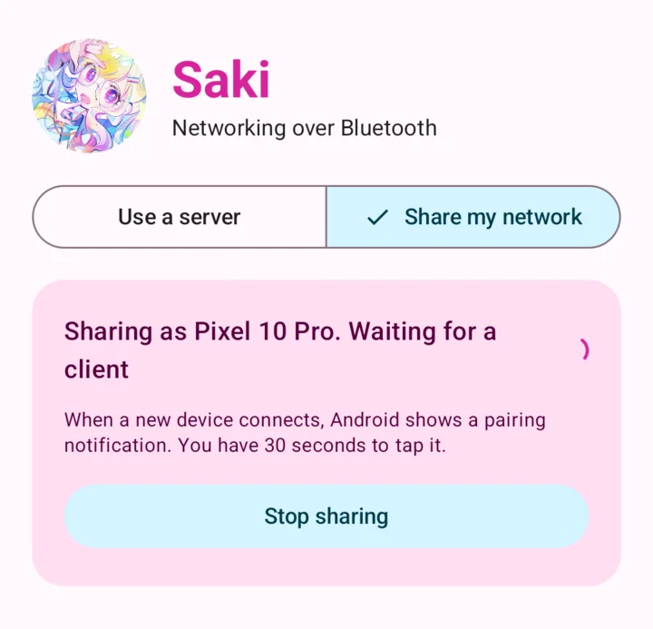

<p align="center">
  
</p>

<h1 align="center">Saki</h1>

<p align="center">Full-duplex networking over Bluetooth.</p>

<p align="center">
  <a href="https://github.com/wonderhoy-labs/saki/actions/workflows/ci.yml"></a>
  <a href="LICENSE"></a>
  <a href="#license-and-credits"></a>
</p>

Saki shares a network connection over Bluetooth. One device, the server, has the network. The other, the client, sends
all of its traffic to the server over Bluetooth, in both directions at once, and it goes out from there.

It's a command-line tool on macOS and Linux and an app on Android, for x86_64 and ARM. Any of them can be either end.

Say your phone has no Wi-Fi or cellular, and your laptop has Wi-Fi and a proxy running as a TUN device called `xray0`. On
the laptop, run this:

```bash
saki server --dev xray0
```

Then open Saki on the phone and tap the laptop. Everything on the phone now goes over Bluetooth to the laptop and out
through `xray0`.



> **This is early.** All our Bluetooth testing was one Pixel 10 Pro on Android 17, with one Mac on macOS 27 and one x86_64 Arch
> Linux laptop. [Here's exactly what that covers.](#what-has-been-tested) If you try anything else, please
> [open an issue](https://github.com/wonderhoy-labs/saki/issues) and tell us how it went, even if it just worked.

## What you need

Two devices with Bluetooth Low Energy, which is nearly anything from the last ten years, and:
- **Android:** Android 10 or newer.
- **macOS:** A recent version. It asks for permission to use Bluetooth the first time, and again after each update.
- **Linux:** BlueZ with `bluetoothd` running, and permission to talk to it over D-Bus. Desktop sessions normally have that.

Being a client on a computer needs root, because it creates a network device. Being a server doesn't, on either system.

Your two devices also have to pair, and if the server is a Mac, that takes [an extra step](#pairing).

## Install

Download the APK or the command-line tool for your system from
[Releases](https://github.com/wonderhoy-labs/saki/releases).

On Android, open the APK on your phone, or install it with `adb`:

```bash
adb install -r saki-v0.1.1.apk
```

On a computer, unpack the tool and put it on your path:

```bash
tar -xzf saki-aarch64-apple-darwin.tar.gz
```

```bash
sudo install saki /usr/local/bin/
```

The builds aren't notarized, so macOS may refuse to run a downloaded one. This tells it you meant to:

```bash
xattr -d com.apple.quarantine /usr/local/bin/saki
```

You can also [build it yourself](#development).

## Use it

### Share a computer's network

```bash
saki server
```

Clients' traffic follows this machine's routes, unless you name a network device or TUN for it to use instead. This works
on Linux and macOS:

```bash
saki server --dev xray0
```

### Share a phone's network

Open Saki, tap **Share my network**, then **Start sharing**. There's no VPN involved, and it doesn't need root.

### Get networking on a phone

Open Saki on **Use a server** and tap a server from the list. Android asks you to allow the VPN the first time. All of the
phone's traffic then goes over Bluetooth, and DNS is answered by a small resolver in the app, which asks 1.1.1.1 through
the tunnel.

Android only runs one VPN at a time, so this replaces any other VPN app. Turn that one back on when you're done.

### Get networking on a computer

Find out what's around, if you need to:

```bash
saki scan
```

Check that the link works. This needs no root and changes nothing on your system:

```bash
saki probe "Pixel 10 Pro"
```

Then connect. You can leave out the name when there's only one server in range:

```bash
sudo saki client "Pixel 10 Pro"
```

This creates a TUN device, sends all of this machine's traffic into it and points DNS at it. On Linux, DNS goes through
`systemd-resolved` if it's running, and otherwise through `/etc/resolv.conf`. It all goes back to normal when `saki` exits. To use a TUN device of your own and handle routing yourself, name it. On macOS, the name has to be `utun` and a number.

```bash
sudo saki client --dev saki7 --no-routes --no-dns
```

### Pairing

The first time two devices connect, they pair. Check that the code matches on both sides before accepting, because that's
what proves you're talking to the right device.
- **When the Android device is the server,** Android shows a notification instead of a dialog, and you have 30 seconds to
  tap it.
- **When the Android device is the client,** it's a normal pairing dialog.
- **On Linux,** `saki` asks in the terminal, and refuses if it has no terminal to ask in. `--accept-pairing` accepts without
  asking, which is for machines nobody's watching.
- **On a Mac,** a dialog appears, but only when the Mac is the client. **A Mac can't accept a first-time pairing as a
  server.** It refuses the request, and macOS logs that there's nobody to handle it. So pair the other way around once:
  turn on sharing on the phone, and run `saki probe` on the Mac. After that the Mac works as a server for that phone.

## What has been tested

"Over Bluetooth" means a real radio link between the Pixel and a computer. The development TCP link is the rest of Saki with
Bluetooth swapped out.

We tested Linux without root. `saki client` ran in an unprivileged user and network namespace, which gives it the same
permissions over its own network devices. **Nobody has run it with `sudo` on a machine's real routes,** or with
`systemd-resolved` running.

| What                                                                   | Status                                                                                                                                                                  |
| ---------------------------------------------------------------------- | ----------------------------------------------------------------------------------------------------------------------------------------------------------------------- |
| Mac as server, Android VPN as client                                   | Works over Bluetooth, with DNS, HTTP and real apps                                                                                                                      |
| Android as server, Mac as `saki probe`                                 | Works over Bluetooth, in debug and release builds, with real DNS through the phone                                                                                      |
| Linux as server, Android VPN as client                                 | Works over Bluetooth, with DNS and HTTP. Disconnecting puts the phone's network back                                                                                    |
| Android as server, Linux as `saki probe`                               | Works over Bluetooth, eight times out of eight, with real DNS through the phone                                                                                         |
| `saki scan` on Linux                                                   | Finds a phone. **It doesn't find a Mac,** whose advertisement didn't show BlueZ the Saki service                                                                        |
| Pairing a phone with Linux                                             | Works, using number comparison and `--accept-pairing`                                                                                                                   |
| The pairing question in a Linux terminal                               | Appears, and refuses when told no, or when there's no terminal. **Answering yes hasn't been run**                                                                       |
| **A Mac and Linux machine with each other**                            | **Not finished.** The Mac finds a Linux server and asks to pair, and we stopped there because nobody was at the Mac to accept                                           |
| `saki client` with a real TUN device                                   | Works on Linux, over TCP in a namespace, with IPv4, DNS and HTTPS. DNS goes back to normal on exit                                                                      |
| `--dev` on Linux                                                       | Works over TCP. `xray0` reaches the internet and `lo` doesn't, so the setting takes effect                                                                              |
| Pairing with the Mac as client                                         | Works, using number comparison                                                                                                                                          |
| Pairing with the Mac as server                                         | [Refused by macOS](#pairing)                                                                                                                                            |
| Disconnecting on Android                                               | Works over Bluetooth                                                                                                                                                    |
| Reconnecting on Android                                                | Works over TCP on an emulator. The tunnel stays up, and traffic resumes about 3 seconds after the server returns                                                        |
| `--dev` on macOS                                                       | Works over TCP. `en0` reaches the internet and `lo0` doesn't, so the setting takes effect                                                                               |
| Downloading and uploading at once                                      | Works over Bluetooth                                                                                                                                                    |
| **`saki client` with a real TUN device over Bluetooth, on any system** | **Never run.** Linux refuses Bluetooth sockets inside a network namespace, so this needs `sudo`. `saki probe` covers Bluetooth, and the row above covers the TUN device |
| **An Android phone with no other network**                             | **Not tried.** The phone had Wi-Fi during testing                                                                                                                       |
| **Intel Macs, ARM Linux, and x86_64 or 32-bit ARM Android**            | **Built, never run.** The emulator was ARM64                                                                                                                            |
| **The Android VPN in a release build**                                 | **Not run over Bluetooth.** Its Bluetooth tests used a debug build                                                                                                      |
| **A sleeping phone, and battery drain**                                | **Not tried**                                                                                                                                                           |

### Speed

Measured from the phone's end of the tunnel, with a 2M PHY and 15 ms connection interval.

| Transfer     | Mac as server: down | Mac as server: up | Linux as server: down | Linux as server: up |
| ------------ | ------------------- | ----------------- | --------------------- | ------------------- |
| Download     | About 440 kbit/s    | About 30 kbit/s   | About 130 kbit/s      |                     |
| Upload       | About 20 kbit/s     | About 420 kbit/s  |                       | About 290 kbit/s    |
| Both at once | 30 to 260 kbit/s    | 175 to 400 kbit/s | Not measured          | Not measured        |

So with a Mac, that's about 450 kbit/s, shared between the two directions. It's fine for messages and light browsing, and not
for video. Ping is 26 to 51 ms when idle and about 620 ms with the link full. The radio should have room for more, so we suspect
the Mac's Bluetooth stack.

With Linux as the server, downloads to the phone are slower. 130 kbit/s is almost exactly one 251-byte packet per connection
event, so it looks like the laptop's Intel AX201 only sends one each time. We haven't measured any other adapter.

## How it works

```
       client                                               server
                                                      the internet, or xray0
  apps and the system                                           ▲
          │                                              ordinary sockets
          ▼                                                     ▲
  TUN device or Android VPN                                     │
          │                                         userspace TCP/IP stack
          ▼                                                     ▲
   small DNS resolver                                           │
          │                                                     │
          └────────── IP packets on a BLE L2CAP channel ────────┘
```

**The link** is a BLE L2CAP connection-oriented channel, which is a plain byte stream in both directions. It's the one
fast Bluetooth transport that all three systems let an app use. A server also offers one GATT characteristic that holds
the channel's number. Reading it needs an encrypted link, so that read is what makes the devices pair. Everything on the
channel is a small frame around an IP packet. [`docs/protocol.md`](docs/protocol.md) has the details.

**The server** needs no root, IP forwarding or firewall rules. Each client gets its own userspace TCP/IP stack, based on
[smoltcp](https://github.com/smoltcp-rs/smoltcp), and every connection the client makes ends there and starts again on a
normal socket. That's how `--dev` works too: those sockets get tied to the device, using `SO_BINDTODEVICE` on Linux and
`IP_BOUND_IF` on macOS, so they ignore the routing table. A TCP connection only gets answered once the real one is up, so
that a client finds out when a destination can't be reached.

**The client** puts its traffic in a TUN device, or a VPN on Android, where Saki reads it. DNS gets special treatment. The
system is told to use a resolver at 10.233.77.1, an address that exists only inside the tunnel. Saki picks those queries
out, answers from a small cache if it can, and otherwise sends them through the tunnel to 1.1.1.1. Bluetooth is slow
enough that the cache makes a difference.

**When Bluetooth can't keep up,** only about 32 packets wait to go out. A longer queue would only add delay. On the server,
the TCP stack waits for room, and UDP that doesn't fit gets dropped. On the client, anything that doesn't fit gets
dropped, and TCP slows down, as it would on a real network.

**The Android app** is Kotlin, including its Bluetooth and its half of the protocol. Server mode needs that same TCP/IP stack,
so that part is the Rust code the command-line tool uses, built into the APK with the NDK.

## Security and privacy

Worth reading before you turn on a server.

**Anyone who has paired with a server can use its network connection.** That includes its local network and anything
listening on its own network addresses, unless you run `saki server --no-lan` or switch on **Keep clients off my local
network**. Clients can't reach the server's own loopback addresses, whatever you set. Being able to pair takes approval on the server, except with
`--accept-pairing` on Linux, which lets anyone in range in.

**Bluetooth is the only encryption Saki adds.** The channel refuses to open without an encrypted link, and pairing is what
sets that up. Compare the codes when you pair, since that's the part that stops someone in the middle. Past the server,
your traffic is as exposed as on any other connection through that server, and the server's owner can see what isn't
encrypted anyway.

**When the link drops, a client's traffic stays put.** The tunnel stays up so that nothing escapes over another network.
Connections that were open are lost, and apps make new ones once Saki reconnects.

The hidden `--dev-tcp` option replaces Bluetooth with plain TCP, for development. It has no pairing or encryption, so
anyone who can connect gets in. Release builds of the app don't include it, but the command-line tool does.

## Options

### `saki server`

| Option             | Default                  | What it does                                                                         |
| ------------------ | ------------------------ | ------------------------------------------------------------------------------------ |
| `--dev DEVICE`     | Follow the routing table | Network device or TUN for clients' traffic. Linux older than 5.7 needs root for this |
| `--name NAME`      | The device's name        | The name clients see                                                                 |
| `--dns IPV4`       | `1.1.1.1`                | The resolver clients use                                                             |
| `--no-lan`         | off                      | Keep clients off private addresses                                                   |
| `--adapter NAME`   | The default one          | Bluetooth adapter to use, Linux only                                                 |
| `--accept-pairing` | off                      | Accept pairing without asking, Linux only. Anyone in range could then pair           |

### `saki client [SERVER]`

| Option             | Default                                    | What it does                                      |
| ------------------ | ------------------------------------------ | ------------------------------------------------- |
| `--dev DEVICE`     | `saki0` on Linux, the next `utun` on macOS | TUN device to use, or to create                   |
| `--no-routes`      | off                                        | Don't send this machine's traffic into the tunnel |
| `--no-dns`         | off                                        | Don't point this machine's DNS at the tunnel      |
| `--once`           | off                                        | Exit when the link drops instead of reconnecting  |
| `--adapter NAME`   | The default one                            | Bluetooth adapter to use, Linux only              |
| `--accept-pairing` | off                                        | Accept pairing without asking, Linux only         |

### Other commands

| Command                           | What it does                                                                           |
| --------------------------------- | -------------------------------------------------------------------------------------- |
| `saki scan [--seconds N]`         | Lists the servers in range. It looks for 10 seconds by default                         |
| `saki probe [SERVER] [--count N]` | Connects, pings the server and does a DNS lookup through it, without changing anything |

Add `-v` to any of them to log more, or `-vv` for even more.

## Troubleshooting

**The phone says it couldn't pair, and the server is a Mac.** A Mac can't accept a first-time pairing as a server.
[Pair the other way around once.](#pairing)

**Pairing fails after 30 seconds with the phone as server.** Android showed a notification, not a dialog, and it wasn't
tapped in time. Run it again and look for the notification.

**macOS asks about Bluetooth again.** It ties the permission to the exact binary, so this happens after each update.

**`saki scan` on Linux doesn't show a Mac.** We haven't got this working. [Run the server on Linux or a phone instead.](#what-has-been-tested)

**`/etc/resolv.conf` says it was written by `saki client`, and it isn't running.** It normally restores this when it exits,
but it can't after `kill -9`. What was there before is in the file as comments.

**`saki client` says `couldn't open the TUN device`.** It needs root, so use `sudo`.

**`saki` says it found more than one server.** Pick one by the name or ID that it lists.

**`can't use network device`.** Check the name with `ip link` or `ifconfig`.

**DNS stays broken on a Mac after `saki client` was force-killed.** It normally restores this when it exits, but it can't
after `kill -9`. This puts it back:

```bash
printf 'remove State:/Network/Service/saki/DNS\n' | sudo scutil
```

**A client can't reach the local network with an Android phone as server.** Android 17 needs the local network
permission for this. Allow it for Saki in the app's settings.

## Known issues

- `saki client` hasn't been run with a real TUN device over Bluetooth. It needs root for that, and we don't know yet how
  Bluetooth on macOS behaves under `sudo`. That may need more work.
- Linux doesn't find a Mac when it scans.
- Downloads to a phone are slower with Linux as the server than with a Mac.
- A Mac can't accept a first-time pairing as a server.
- About 450 kbit/s at best, in the setups we've measured.
- Latency climbs to over half a second when the link is full, and one big transfer can slow everything else down.
- Pinging through a server needs a system that allows unprivileged ICMP sockets. If it doesn't, pings just go unanswered.
- UDP replies too big for the tunnel's 1280-byte MTU get dropped, since the stack can't fragment them.
- There's no way yet to change the DNS resolver from the Android app when it's the server, so it always uses 1.1.1.1.
- An unpaired server's address can change, so on Android Saki finds it again by name, and two servers with the same name
  could get mixed up.

## Development

You need Rust 1.91 or newer. For the Android app you also need JDK 17 or newer, the Android SDK with platform 37, NDK 30.0.16248370
and [cargo-ndk](https://github.com/bbqsrc/cargo-ndk). On Linux you also need `libdbus-1` and `pkg-config`. The shared tools need
Node 24 or newer and pnpm.

Saki follows the [Wonderhoy Labs guideline](.claude/skills/wonderhoy-unification/SKILL.md), like every Wonderhoy Labs project.
Format before you commit, and check the result:

```bash
cargo fmt --all && (cd android && ./gradlew spotlessApply) && pnpm format
```

```bash
pnpm install && pnpm unify
```

```bash
cargo test --workspace
```

```bash
cargo build --release -p saki
```

```bash
cd android && ./gradlew :app:testDebugUnitTest :app:assembleRelease
```

Adding `-Psaki.abis=arm64-v8a` builds the app faster, for one kind of device. The APK ends up at
`android/app/build/outputs/apk/release/app-release.apk`. It's signed with your debug key unless you set `SAKI_KEYSTORE`,
`SAKI_KEYSTORE_PASSWORD`, `SAKI_KEY_ALIAS` and `SAKI_KEY_PASSWORD`.

| Where                                                 | What's in it                                                                                   |
| ----------------------------------------------------- | ---------------------------------------------------------------------------------------------- |
| `crates/saki-core/`                                   | The protocol, the NAT, the DNS resolver and the session logic, shared by everything            |
| `crates/saki/src/bt/`                                 | Bluetooth on macOS and Linux                                                                   |
| `crates/saki/src/tunnel.rs`                           | The client's TUN device, routes and DNS settings                                               |
| `crates/saki-jni/`                                    | Lets the Android app use the NAT                                                               |
| `android/app/src/main/kotlin/com/wonderhoylabs/saki/` | The Android app                                                                                |
| `docs/protocol.md`                                    | The wire protocol                                                                              |
| `tools/`                                              | The shared Wonderhoy Labs tools: `theme.ts` makes the colours, `unify.ts` checks the guideline |

The protocol exists in both Rust and Kotlin. Their tests check the same bytes, so change them together.

Pushing a tag like `v0.1.0`, matching `VERSION`, builds everything and publishes a GitHub release through
[ci.yml](.github/workflows/ci.yml). It signs the APK with the repository's `SAKI_KEYSTORE_BASE64`, `SAKI_KEYSTORE_PASSWORD`,
`SAKI_KEY_ALIAS` and `SAKI_KEY_PASSWORD` secrets. Without them, each release gets a throwaway key and has to be installed
fresh instead of updating.

<details>
<summary>Testing without Bluetooth</summary>

Neither an emulator's Bluetooth nor any simulator can reach a real radio. For everything above Bluetooth, both ends can use
TCP instead. On the computer:

```bash
saki -v server --dev-tcp 127.0.0.1:47474
```

On an emulator, with a debug build, this connects its VPN to that server:

```bash
adb shell am start -n com.wonderhoylabs.saki/.ui.MainActivity --es dev_tcp 10.0.2.2:47474
```

To test the app as a server, forward a port and probe it from the computer:

```bash
adb shell am start -n com.wonderhoylabs.saki/.ui.MainActivity --ei dev_tcp_listen 47475
```

```bash
adb forward tcp:47475 tcp:47475
```

```bash
saki probe --dev-tcp 127.0.0.1:47475
```

To test over real Bluetooth with a locked phone, this starts sharing without a tap, though a first-time pairing still needs one:

```bash
adb shell am start -n com.wonderhoylabs.saki/.ui.MainActivity --ez dev_share true
```

</details>

## Under the hood

None of this is needed to use Saki. It's here so nobody has to work it out twice.

<details>
<summary>Things we learned the hard way</summary>

- **macOS kills a tool for using Bluetooth under the wrong app.** It holds whichever app started a process responsible for
  what it does, and aborts the process if that app never declared why it wants Bluetooth. That can't be caught, and it
  depends on the user's terminal. So `saki` embeds its own usage description in the binary and restarts itself once at
  launch, using `responsibility_spawnattrs_setdisclaim`. That's a private call, which Chromium and LLDB also use, so it's looked
  up at runtime. macOS then asks about "Saki" by name.
- **A Mac refuses first-time LE pairing as a peripheral.** `bluetoothd` logs `Denying pairing request ... as there's no one
  to handle the request`. With the Mac as central, `BluetoothUIServer` appears and pairing works, and the resulting bond
  works in both roles. Pairing over LE also bonded BR/EDR, through cross-transport key derivation.
- **Android 17 blocks private addresses without `ACCESS_LOCAL_NETWORK`,** and the connection just times out. It's easy to
  mistake for a network problem.
- **`VpnService.protect` needs a real socket.** A new Java `Socket` doesn't have one until it's bound. Without that, the
  call has nothing to act on, and a tunnel's own connection loops back into the tunnel once the VPN is up.
- **With no other network, Android can treat a VPN as offline,** unless it names itself as its own underlying network. The
  trick comes from [gnirehtet](https://github.com/Genymobile/gnirehtet). We've kept it, but we haven't tried it without
  Wi-Fi.
- **We started on the `ipstack` crate and moved away.** It only checks its retransmit timers when another packet arrives,
  so a dropped tail packet stalled the connection, and in our tests a closing server's FIN never went out.
  `netstack-smoltcp` doesn't have those problems, and turning on smoltcp's `socket-tcp-reno` feature adds congestion control.
- **BlueZ can hide what you ask it to find.** A scan filtered to the Saki service found nothing on an Intel AX201, with a phone
  right there advertising it, and the same scan with no filter listed that phone with that service. So Saki filters for itself.
- **BlueZ announces a device before it knows much about it.** Its services and name can arrive later, so a check made once on
  arrival can miss a server for good.
- **Pairing changes a phone's address.** It advertises from a random address, and pairing reveals its real one. Dialing the old
  one after that just times out.
- **BlueR's L2CAP `connect` can return before the channel is up.** It waits for the socket to be writable, which a new socket
  is from the start, and the runtime can remember that. The first write then fails with `ENOTCONN`, but only sometimes. The
  kernel's `L2CAP_CONNINFO` only answers once a channel is really open, so that's what Saki waits for.
- **Discovering services resets the connection's priority on Android.** Asking for a high priority first gets undone, leaving a
  45 ms interval. A Mac asks for a fast interval by itself, which hid this until Linux, where it cost two thirds of the speed.
- **`netstack-smoltcp` answers every ping if you let it,** whether or not the destination exists, so Saki relays pings
  itself.

</details>

## License and credits

Saki is a [Wonderhoy Labs](https://github.com/wonderhoy-labs) project, released under the
[Apache License 2.0](LICENSE). It isn't affiliated with the Bluetooth Special Interest Group. Bluetooth is its trademark.

It stands on the work of these projects, each under its own permissive license:
- [smoltcp](https://github.com/smoltcp-rs/smoltcp) (0BSD) and
  [netstack-smoltcp](https://github.com/automesh-network/netstack-smoltcp) (MIT or Apache 2.0), the userspace TCP/IP stack
- [BlueR](https://github.com/bluez/bluer) (BSD 2-Clause), for Bluetooth on Linux
- [objc2](https://github.com/madsmtm/objc2) (MIT, and Zlib, Apache 2.0 or MIT for its framework bindings), for Bluetooth on macOS
- [rust-tun](https://github.com/meh/rust-tun) (WTFPL), for TUN devices
- [Tokio](https://github.com/tokio-rs/tokio) (MIT), for everything asynchronous in Rust
- [Jetpack Compose and AndroidX](https://developer.android.com/jetpack) (Apache 2.0), for the Android app
- [Material Color Utilities](https://github.com/material-foundation/material-color-utilities) (Apache 2.0), which makes the app's
  colours from Saki's image colour

Saki is named for Tenma Saki of Leo/need, from Project SEKAI COLORFUL STAGE! feat. Hatsune Miku. Wonderhoy Labs is a fan
project, not affiliated with SEGA, Colorful Palette or Crypton Future Media, who own Project SEKAI and its characters. The
Apache License doesn't cover the Saki name or logo.
